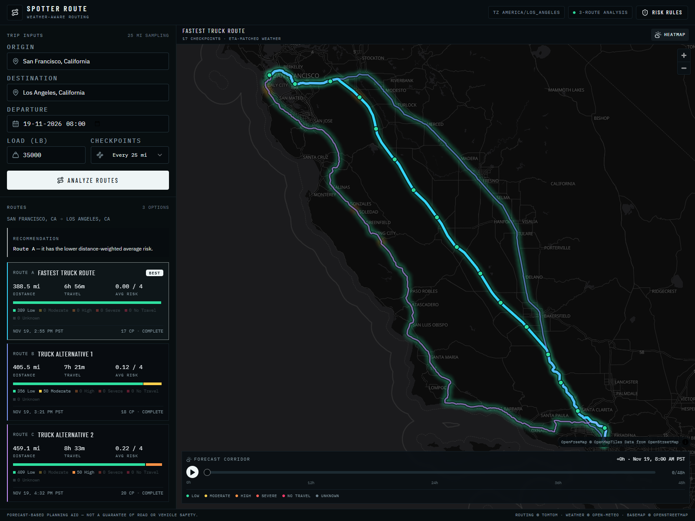
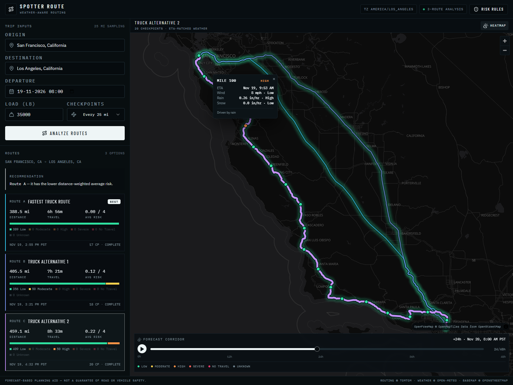
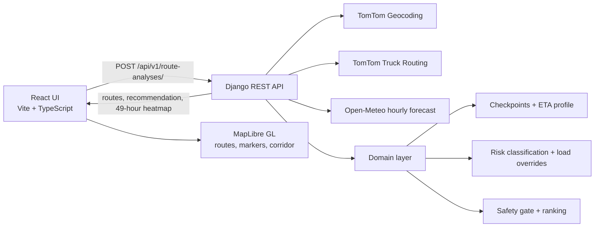
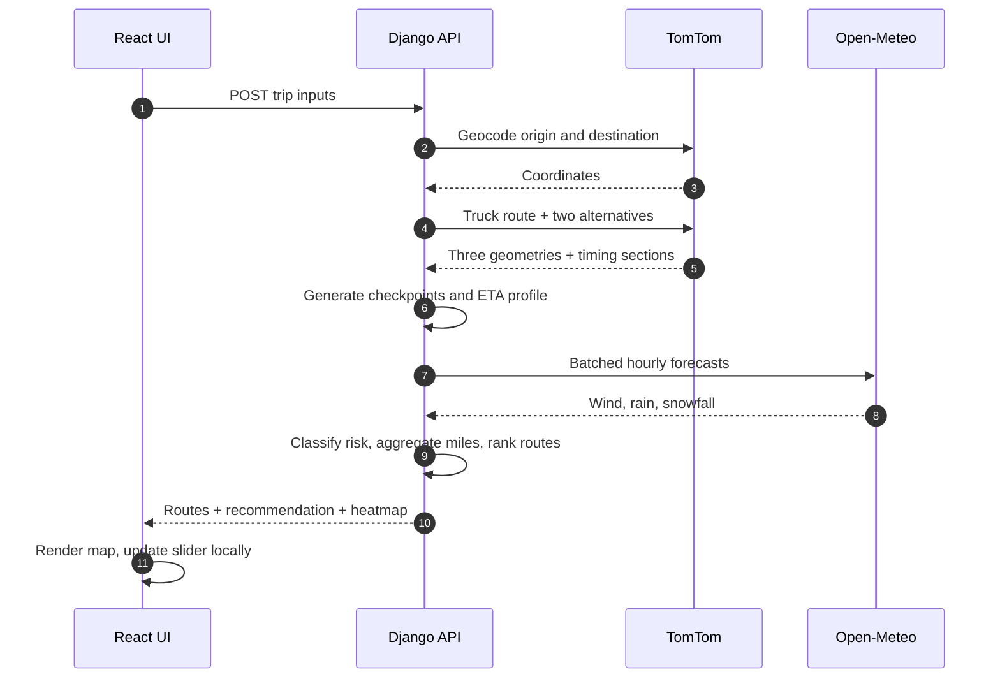
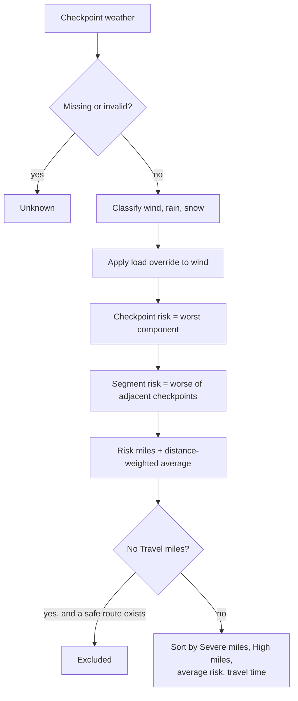
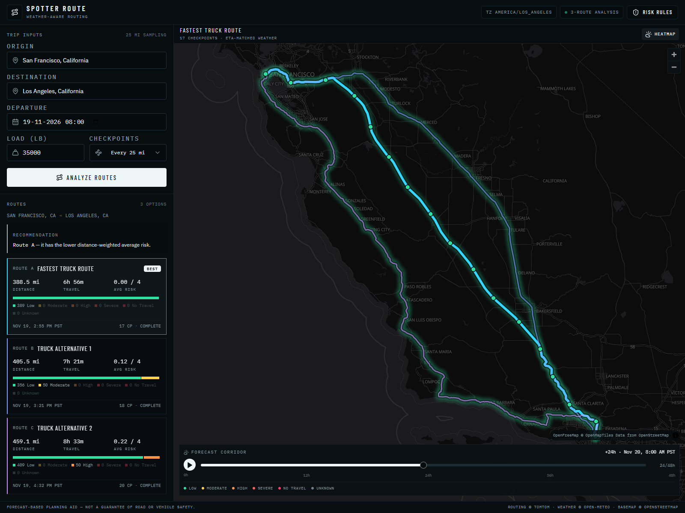
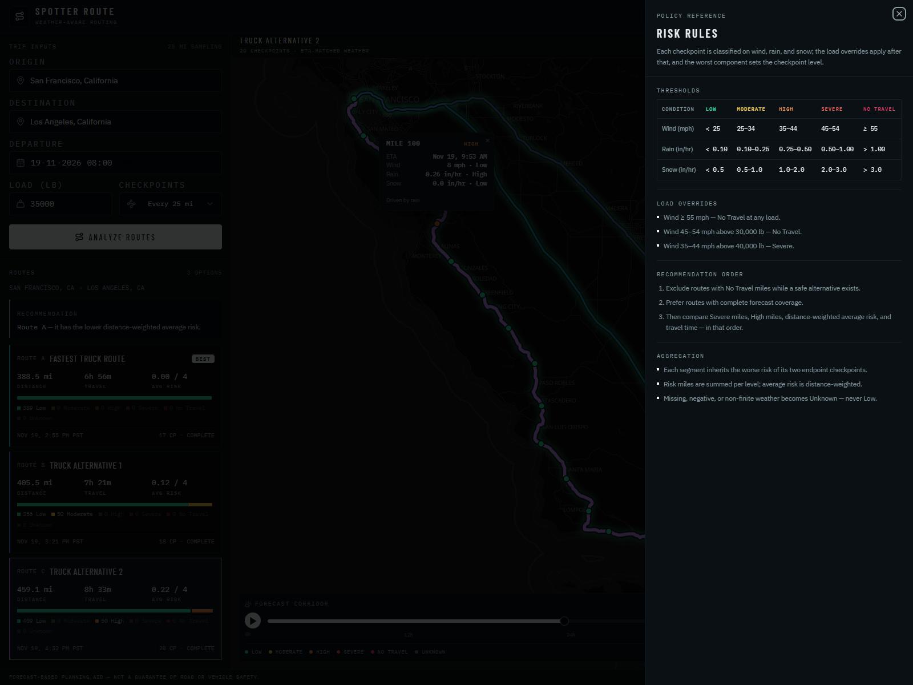
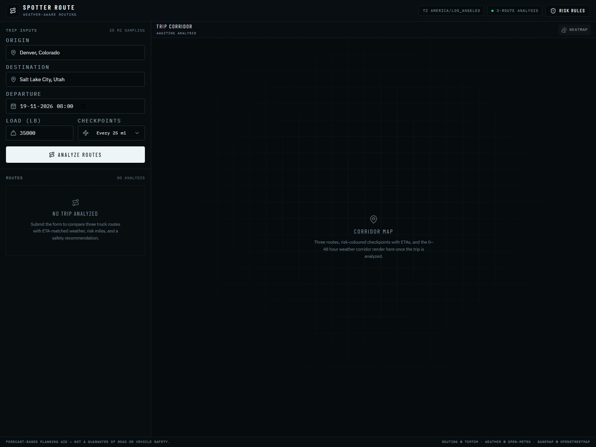

# Spotter Route

**Weather-aware truck routing for safer dispatch decisions.**

A driver enters an origin, destination, departure time, and load weight. Spotter Route
pulls three real truck routes, samples the forecast at each checkpoint using the truck's
estimated arrival time, applies the assignment's wind/rain/snow and load rules, and
recommends a route with an explainable safety-first ordering.

Built with **React + TypeScript + MapLibre GL** on the frontend and **Django REST Framework**
on the backend. Verified end to end against live TomTom and Open-Meteo APIs.



## What this demonstrates

- **Correct domain logic.** Every risk threshold, load boundary, mileage aggregation, and
  ranking rule is implemented once in a framework-free Python domain layer and covered by
  tests — including the strict `> 30,000 lb` and `> 40,000 lb` cases.
- **Real provider integration.** TomTom truck routing returns three distinct geometries;
  duplicate alternatives are rejected rather than faked to satisfy a count.
- **ETA-aware weather.** Checkpoints are placed on route geometry at 10/25/50-mile spacing,
  and each one is scored against the forecast hour matching its own ETA.
- **A recommendation you can defend.** The UI explains the deciding criterion, and the
  ordering matches the brief: Severe miles → High miles → average risk → travel time.
- **A map that stays responsive.** All 49 heatmap hours are fetched once; dragging the
  slider recolors the corridor locally without another request.
- **Honest failure states.** Missing provider data becomes **Unknown**, never Low, and an
  incomplete route cannot beat a complete one.

## The result at a glance

The screenshot above is a live San Francisco → Los Angeles analysis at 35,000 lb, 25-mile
sampling, departing Nov 19 at 08:00 PST:

| Route | Distance | Travel | Average risk | Risk profile |
| --- | ---: | ---: | ---: | --- |
| **A — Fastest** (recommended) | 388.5 mi | 6h 56m | **0.00 / 4** | 389 Low |
| B — Alternative 1 | 405.5 mi | 7h 21m | 0.12 / 4 | 50 Moderate miles |
| C — Alternative 2 | 459.1 mi | 8h 33m | 0.22 / 4 | 50 High miles |

Route C is not chosen despite being a real truck route: it carries 50 High-risk miles.
Route A wins over Route B on distance-weighted average risk after Severe and High miles tie.
The recommendation text in the UI names that exact criterion.

The popup below is a checkpoint on the selected alternative: **Mile 100, ETA 9:53 AM,
0.26 in/hr rain → High**, with wind and snow still Low. The cause is shown explicitly.



## How it works





The backend owns provider access and every rule. The browser receives normalized analysis
data only; API keys never enter the frontend bundle.

## Risk engine

### Thresholds

| Condition | Low | Moderate | High | Severe | No Travel |
| --- | --- | --- | --- | --- | --- |
| Wind | `< 25 mph` | `25–34` | `35–44` | `45–54` | `≥ 55 mph` |
| Rain | `< 0.10 in/hr` | `0.10–0.25` | `0.25–0.50` | `0.50–1.00` | `> 1.00` |
| Snow | `< 0.5 in/hr` | `0.5–1.0` | `1.0–2.0` | `2.0–3.0` | `> 3.0` |

The brief's table has touching endpoints, so the implementation uses explicit half-open
intervals: `25 <= wind < 35` is Moderate, `0.50 <= rain <= 1.00` is Severe, and
`2.0 <= snow <= 3.0` is Severe. Invalid, negative, or missing measurements become
**Unknown**, never Low.

### Load overrides

- Wind `>= 55 mph` → **No Travel** for every load.
- Wind `45–54 mph` and load `> 30,000 lb` → **No Travel**.
- Wind `35–44 mph` and load `> 40,000 lb` → **Severe**.

Overrides can only increase risk. Exactly 30,000 lb and exactly 40,000 lb do not trigger
their respective gates — both boundaries are tested.

### Aggregation and recommendation



- Each segment is the distance between adjacent checkpoints; it inherits the worse risk
  of its two endpoints, so a dangerous boundary reading never disappears between samples.
- Risk miles are summed by level. Average risk is distance-weighted using
  `Low=0, Moderate=1, High=2, Severe=3, No Travel=4`; Unknown miles are excluded.
- Routes with No Travel miles are ineligible while a safe alternative exists.
- Complete routes beat incomplete routes.
- Final ordering: fewest Severe miles → fewest High miles → lowest average risk →
  shortest travel time. Route ID is a deterministic final tie-break.

### Why these choices

| Decision | Reason |
| --- | --- |
| Three distinct geometries required | A route count is a correctness claim, not a UI label. Fewer than three returns `422` instead of duplicating data. |
| Load weight drives risk only | The assignment defines load as a risk input. It is not passed as gross vehicle weight to the routing provider. |
| Missing data is Unknown | Treating an unavailable forecast as clear weather would make the tool unsafe. |
| Conservative segment risk | Endpoint-based segments prevent a dangerous reading from disappearing between checkpoints. |
| Heatmap preloaded | All 49 hours arrive in one response; slider movement is local, so the map stays smooth. |
| Backend-owned thresholds | React displays results and never reimplements safety rules. |

## Forecast heatmap



- Hour `0` is the requested departure; hour `48` is departure + 48 hours.
- The corridor is buffered 12 miles around the union of all three routes, then
  de-duplicated to a bounded point budget.
- Every grid point carries 49 risk scores computed with the entered load weight.
- Moving the slider changes MapLibre layer data locally; it does not refetch the API.
- Missing forecast cells stay visually distinct as **Unknown**.

## Engineering notes

- **Time zones:** the client sends an ISO 8601 departure with an explicit offset plus an
  IANA zone for display. Django rejects naive timestamps and calculates in UTC.
- **ETA model:** TomTom route progress provides distance/duration sections; a checkpoint
  inside a section interpolates that section's duration by distance.
- **Validation:** past departures, departures beyond the forecast horizon, invalid zones,
  identical endpoints, and invalid checkpoint intervals are rejected at the boundary.
- **Request behavior:** a newer submission aborts the previous request; map sources/layers
  are updated in place instead of rebuilding the map.
- **Provider failures:** timeouts and unusable responses return structured `4xx/5xx` errors
  without exposing provider keys.

## Screenshots

### Risk rules reference

The in-app drawer documents the same thresholds, load overrides, aggregation, and ranking
order implemented by the backend.



### Start state



## Verification

Commands run locally:

```bash
cd backend && python -m pytest -q     # 49 passed
npx tsc -b --pretty false             # exit 0
npx vite build                        # production build succeeded
```

Live smoke tests against TomTom and Open-Meteo:

| Check | Result |
| --- | --- |
| HTTP status | `201` |
| Routes | 3 distinct truck routes |
| Checkpoints at 25 mi | 23 / 23 / 21 (origin and destination included) |
| Checkpoints at 10 mi | 55 / 54 / 50 |
| Checkpoints at 50 mi | 12 / 12 / 11 |
| Heatmap | 49 timestamps, departure +0 through +48 |
| Live response | ~610–660 KB, 5.6–7.9 s |

The test suite covers every threshold boundary, both strict load boundaries, Unknown
handling, distance-weighted aggregation, all four ranking criteria, No Travel gating,
incomplete analyses, checkpoint geometry, ETA interpolation, provider normalization, and
the HTTP contract.

## Run locally

Prerequisites: Python 3.12+, Node.js 20+, and a TomTom API key.

### Backend

```bash
cd backend
python -m venv venv
# Windows: venv\Scripts\activate
# macOS/Linux: source venv/bin/activate
pip install -r requirements.txt
cp .env.example .env       # set TOMTOM_API_KEY
python manage.py migrate
python manage.py runserver 127.0.0.1:8000
```

### Frontend

```bash
npm install
cp .env.example .env       # VITE_API_BASE_URL=http://localhost:8000
npm run dev
```

Open `http://localhost:5173`. The frontend also accepts `VITE_MAP_STYLE_URL`; otherwise it
uses OpenFreeMap with an OpenStreetMap raster fallback.

### Environment variables

| Variable | Purpose |
| --- | --- |
| `TOMTOM_API_KEY` | Server-side geocoding and truck routing |
| `TOMTOM_TIMEOUT_SECONDS` | TomTom request timeout |
| `OPEN_METEO_TIMEOUT_SECONDS` | Open-Meteo request timeout |
| `DJANGO_SECRET_KEY` | Django secret; required when `DJANGO_DEBUG=false` |
| `DJANGO_DEBUG` | `true` for local development |
| `DJANGO_ALLOWED_HOSTS` | Comma-separated host allowlist |
| `FRONTEND_ORIGINS` | Comma-separated CORS origins |
| `ANALYSIS_THROTTLE_RATE` | Anonymous rate limit, e.g. `12/hour` |

## API

| Endpoint | Purpose |
| --- | --- |
| `GET /api/v1/health/` | Health check without calling providers |
| `POST /api/v1/route-analyses/` | Geocode, route, forecast, assess, and rank |

```json
{
  "origin": "San Francisco, California",
  "destination": "Los Angeles, California",
  "departure_time": "2026-11-19T08:00:00-08:00",
  "departure_timezone": "America/Los_Angeles",
  "load_weight_lb": 35000,
  "checkpoint_interval_miles": 25
}
```

See [`docs/api-contract.md`](docs/api-contract.md) for the full response shape and error
codes (`400` validation, `422` no three-route analysis, `429` throttle, `502/504` provider).

## Project structure

```text
backend/
  config/                  Django settings and URLs
  route_analysis/
    api/                   Serializers, views, error mapping
    domain/                Checkpoints, corridor, ETA, risk, ranking
    providers/             TomTom and Open-Meteo adapters
    services/              Analysis orchestration
    tests/                 49 domain, provider, service, and API tests
src/
  api/                     Typed API client
  components/              MapLibre map and UI primitives
  types/                   Analysis response types
docs/
  api-contract.md          Request/response contract
  implementation-plan.md   Design decisions and acceptance criteria
  screenshots/             Screenshots used here
```
## Attribution

Routing and geocoding © TomTom · Weather data by Open-Meteo · Basemap © OpenStreetMap.
